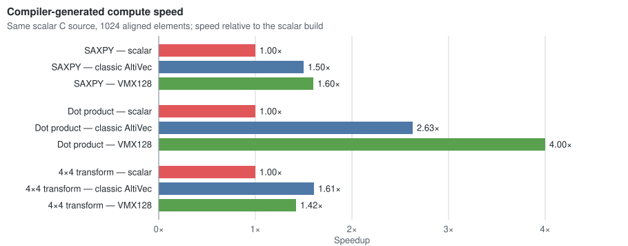

# Xenon Forge

> [!NOTE]  
> This project was entirely developed by AI agents, but human-guided by someone who knows a fair amount about the Xbox 360 and the toolchain components involved. This README was written by a human. Most other documentation was not, but this will hopefully change over time.

Xenon Forge is a buck2/LLVM-based toolchain for Xbox 360. This repo was originally intended as a PoC for getting Rust running on Xbox 360, but has since evolved into a generic toolchain.

The toolchain has three main custom things to it:

1. The Xbox 360 Xenon processor is a 64-bit processor running in 32-bit mode. LLVM doesn't really support this today, its PPC64 support is generally pretty broken, and LLVM only emits ELF32 for PPC32 binaries. To get the binaries running on an Xbox 360, we statically rewrite from ELF32 to PE then pack that as an XEX2 using [`xex-link`](/src/crates/xex-link).
2. **Optional**: For Rust, [we must patch `stdlib`](/toolchain/rust-std-xbox360) to enlighten the standard library about Rust APIs (filesystem, networking, etc.)
3. **Optional**: For proper Xenon processor support, [we have a fork of LLVM](https://github.com/llvm/llvm-project/compare/main...landaire-contrib:llvm-project:xbox360-abi-upstream-complete) which fixes some bugs in the PPC backend, adds support for PPC64-ILP32 (modeled off how MSVC emits code for Xenon), and also adds support for VMX128 instructions.

In order to use this toolchain you ONLY need [`buck2`](https://buck2.build/) for the build system, and a Rust compiler. In general, `buck2` will take care of resolving all dependencies (even the compilers), so all you need to do is run `bin/buck2` to get started.

In general I have attempted to provide prebuilt binaries (built by GitHub actions) for most components to reduce the annoyances put on you.

## Usage

This repo is intended to be consumed by other `buck2` projects as an external cell, and is not meant to be directly modified. See [`xenon-forge-template`](https://github.com/landaire/xenon-forge-template) for a project you _should_ clone and start hacking on.

As outlined [below](#components), there are quite a few components to this toolchain. The good news is: you don't have to worry about installing any of it! The build system will handle pulling _most_ dependencies on its own.

> [!NOTE]  
> **For Windows users**: this has only been tested on Windows 11 which is known to provide `tar.exe`. Older versions of Windows certainly do not, so some of these commands may not work. It is recommended that you read the [bootstrap script](/bootstrap.ps1) and fix it up to resolve `dotslash` if it doesn't work on its own. Once you resolve `dotslash` everything else should "just work".

In general, you need to use `buck2` for building. I recommend just using `bin/buck2` / `bin/buck2.cmd` as this will download the `20216-10-15` version which the project has been tested against (newer versions might have some breakage).

### Nix

If you are a `nix` user, you can use `nix develop` to set up all requirements automatically. If you use `devenv`, run `devenv allow`. Otherwise, see below.

### Non-Nix

You will need, somewhere in your `$PATH` on Unix:

- `c++` (a compiler such as `gcc` or `clang`)
- macOS: Xcode command-line tools and `c++`

On Windows:

- Visual Studio Build Tools
    - Desktop development with C++
    - MSVC x64/x86 or ARM64 tools matching the host
    - Windows 10/11 SDK
- Long paths enabled
- PowerShell
- Internet access for the first build
- `clang.exe` in your `$PATH` if you wish to use C

> [!CAUTION]
> Running any of the build commands will likely download hash-pinned dependencies. See the [bootstrap scripts](/bootstrap.ps1), the [`buck2` dotdlash config](/toolchains/buck2), and [prebuilt toolchain download](https://github.com/landaire/xenon-forge/blob/c936579923a06ce3b2338cf205b4f40308c8e23c/buck/custom_toolchain.bzl#L42-L55).

On a Unix system run:

```
bin/buck2 build //src/examples/hello:hello --show-output
```

On Windows:

```
bin/buck2.cmd build //src/examples/hello:hello --show-output
```

### Build modes and code generation

Builds are in `dev` mode by default: C and C++ compile with `-O0 -g` and console Rust with `-Copt-level=0`. `release` optimizes (`-O2`, `-Copt-level=z`) and keeps debug information in the ELF; `release-no-symbols` drops it. The standard library crates are optimized in every mode. Select a mode with a mode file, which needs no setup:

```
bin/buck2 build @xbox360//mode/release //src/examples/hello:hello
```

or with a modifier, which also selects the PPC64-ILP32 code generation (`-m ppc64-ilp32`):

```
bin/buck2 build -m release -m ppc64-ilp32 //src/examples/hello:hello
```

A project that uses this repository as a cell enables the modifiers in its root `PACKAGE` file:

```starlark
load("@xbox360//buck:modes.bzl", "xbox360_modifiers")

xbox360_modifiers()
```

### C and C++

C and C++ titles are `xbox360_c_title` targets with `//src/sdk:crt` in `deps` and `int main(int argc, char **argv)`; DLLs use `//src/sdk:crt-dll` and `DllMain`. `compiler_flags` add to the flags of the mode. Titles get the link script that xex-link derives from their `xex.toml` unless they set `link_script`. See [`src/examples/chello`](/src/examples/chello).

### Advanced Usage

You can set some settings in your `.buckconfig.local` file (create it if it doesn't exist) that allow for advanced build steps:

```toml
[xbox360]
  console_xbdm = "console_name_or_ip"
  xbdm_tool = "/path/to/xeedee"
```

And the following optional keys:

```toml
[xbox360]
  deploy_directory = "DEVKIT:\\MyTitle"

  kd_tool = "/path/to/openxbdm-kd"
  console_kd_target = "192.168.1.27"

  gdb_tool = "/path/to/powerpc-gdb"
  gdb_listen = "127.0.0.1:2159"
```

This will allow you to build, deploy, and run directly to your console:

```shell
bin/buck2 run //src/examples/hello:hello

# With arguments
bin/buck2 run //src/examples/hello:hello -- first "second argument"

# Debug
bin/buck2 run //src/examples/stdhello:stdhello[debug]
```

If running the `[debug] flavor:

1. Uploads the XEX.
2. Starts `openxbdm-kd` with 32-bit registers and a load stop.
3. Waits until the KD GDB server is armed.
4. Launches the title through `xeedee`.
5. Waits until the title is mapped and stopped before its entry point.
6. Opens GDB with the title ELF, source mappings, big-endian mode, and the PowerPC architecture.

You can also debug from something like VS Code using:

```shell
bin/buck2 build //games:launcher[vscode] --show-output
```

## Components

- [`xex-link`](/src/crates/xex-link) converts an ELF to XEX
- [`xbox360-asm-rewrite`](/src/crates/xbox360-asm-rewrite) contains multiple features, but is mostly used for rewriting some suboptimal assembly patterns LLVM emits (such as using common functions for saving/restoring GPRs)
- [rust-std-xbox360](/toolchain/rust-std-xbox360) enlightens the Rust stdlib to be Xenon-aware
- [/src/crates/xbox360*](/src/crates) provides Xbox 360 SDK support to Rust. Currently at this time includes GPU, video, XAM, and direct system `extern` APIs for invoking threads, networking, etc. without `stdlib`.
- [/src/sdk](/src/sdk) is the C SDK: headers for the kernel and XAM imports, the thunk library that C, C++ and Rust link to call them, and a small C runtime. A C or C++ title adds `//src/sdk:crt` to its `deps`, includes `<xbox360/xboxkrnl.h>` and defines `int main(int argc, char **argv)`. A DLL or system module adds `//src/sdk:crt-dll` and defines `BOOL DllMain(HANDLE, DWORD, PVOID)`. The Rust bindings are generated from the same headers.
- [LLVM fork](https://github.com/llvm/llvm-project/compare/main...landaire-contrib:llvm-project:xbox360-abi-upstream-complete) (see below)[#llvm-fork].

External tools (hash-pinned downloads) include:

- [dotslash](https://github.com/meta/dotslash): handles downloading of hash-pinned tools from GitHub releases
- [buck2](https://github.com/facebook/buck2): our build system.
- [openxbdm](https://github.com/landaire/openxbdm) (xeedee/openxbdm-kd etc.): for communicating with the console on deployments.
- LLVM fork IF `ppc64` is targeted
- [Various Rust crates](/third-party/rust/BUCK) for 1P crates / other tooling

### xex-link

Since LLVM at this time doesn't know how to emit a PowerPC Portable Executable (PE), we must emit an ELF and do the conversion process ourself.

LLVM obviously does not, and likely will never (for legal reasons (encryption keys)), emit an XEX either. xex-link handles the conversion of an ELF -> PE -> XEX all in one step.

Example usage:

```shell
xex-link input.elf output.xex \
  --manifest xex.toml \
  --resource SHADER=<artifact path> \
  --resource FONT=<artifact path>
```

`xex-link link-script link.x --manifest xex.toml` writes the GNU ld script that the ELF is linked with: code one page above `load_address` (the first page holds the headers), and code, read-only data, data and zero-initialized data each on their own pages (4 KB with `SMALL_PAGES`, otherwise 64 KB). The title rules use it unless a target sets `link_script`.

As part of our build integration, xex-link reads a manifest (`xex.toml` in the project's directory) which contains attributes that will make their way into the XEX header:

```toml
title_id = 0x00000000       # integer
media_id = 0x00000000       # integer
load_address = 0x82000000   # image base the ELF was linked at
version = "0.0.0.0"         # title and export table version: a.b.c.d or "0xHEX"
base_version = "0.0.0.0"    # minimum loader version, same format
image_flags = []            # ImageFlags names or "0xHEX", e.g. ["SMALL_PAGES"]
module_flags = ["TITLE"]    # ModuleFlags names or "0xHEX"
compress = false            # LZX-compress the image (Normal, 64 KB window)
tls_slots = 64              # TLS_INFO slots, 0 omits the header; default 64 with TITLE, none otherwise
# bounding_path = '\Device\Harddisk0\Partition1\DEVKIT\FlashEx\xbdm.xex'
# encrypt = "devkit"        # encrypt with the "devkit" or "retail" master key

[imports]
version = "2.0.21173.0"     # imported module version
min_version = "2.0.1861.0"  # minimum imported module version

# Emits an export table; module is required when the table is present.
# [exports]
# module = "xbdm.xex"       # xboxkrnl.exe, xam.xex, or xbdm.xex
# min_version = "2.0.1861.0" # oldest compatible version in the export table
```

The load address must match the image base the ELF was linked at and must be a multiple of the page size: 64 KB, or 4 KB with `SMALL_PAGES`.

xex-link also handles embedding of data in the XEX, but this does not get declared in the `xex.toml` since the build system must be aware of the dependencies. Instead, the `xbox360_title` declares the `resources`:

```starlark
resources = {
    "SHADER": ":compiled_shader",
    "FONT": "font.bin",
}
```

### LLVM Fork

Our [LLVM fork](https://github.com/llvm/llvm-project/compare/main...landaire-contrib:llvm-project:xbox360-abi-upstream-complete) adds the `powerpc64-unknown-xbox360` target and VMX128 support. It is optional; the default PPC32 target remains supported.

LLVM auto-vectorizes scalar loops that the SDK compiler leaves scalar:

| Compiler configuration          | Kernels with generated SIMD, out of 44 |
| ------------------------------- | -------------------------------------: |
| SDK C compiler `/O2`            |                                      0 |
| Clang `-O3 -mno-altivec`        |                                      0 |
| Clang `-O3 -mno-vmx128`         |                                     25 |
| Clang `-O3`, VMX128             |                                     25 |
| Clang `-O3 -ffast-math`, VMX128 |                                     26 |
| Rust `-O3`, VMX128              |                                     24 |

On 1024-element compiler-generated C kernels, the scalar-to-AltiVec-to-VMX128 progression depends on the workload:



Vector loads improve cached copies over scalar code; large copies are memory-bound:


See [the full VMX128 measurements](/docs/vmx128-measurements.md) for methodology and raw results.

### Rust stdlib

The `stdlib` for Rust works, but does add some bloat to your binary. Below are some measurements I took from my [`openxbdm`](https://github.com/landaire/openxbdm) project which is `no_std` compared against the same library using `std`:


| Standard library         | Panic strategy    | `.text` | `.data` | `.bss` | `.xthunks` | Loaded image | XEX file |
| ------------------------ | ----------------- | ------: | ------: | -----: | ---------: | -----------: | -------: |
| None (`no_std`)          | `immediate-abort` | 695,724 | 140,146 | 68,912 |      3,648 |      909,250 |  356,352 |
| `std`                    | `immediate-abort` | 695,716 | 140,146 | 68,928 |      7,248 |      912,858 |  360,448 |
| `std` for system modules | `immediate-abort` | 695,716 | 140,146 | 68,928 |      7,248 |      912,858 |  360,448 |
| None (`no_std`)          | `abort`           | 718,884 | 140,594 | 68,912 |      3,648 |      932,858 |  364,544 |
| `std`                    | `abort`           | 748,492 | 173,594 | 77,188 |      7,376 |    1,007,470 |  391,168 |
| `std` for system modules | `abort`           | 748,492 | 173,594 | 77,188 |      7,376 |    1,007,470 |  391,168 |
